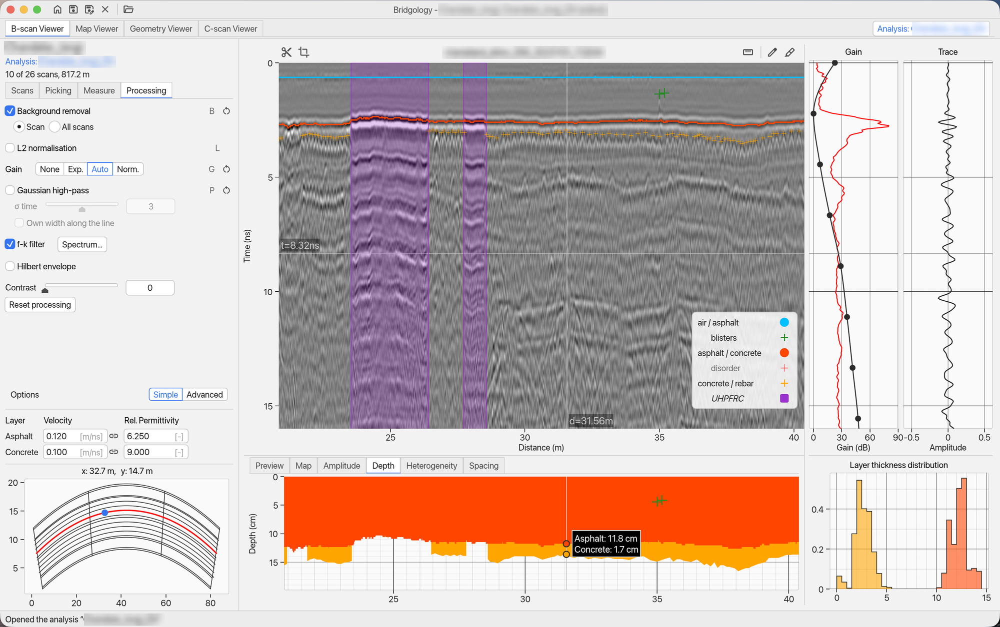
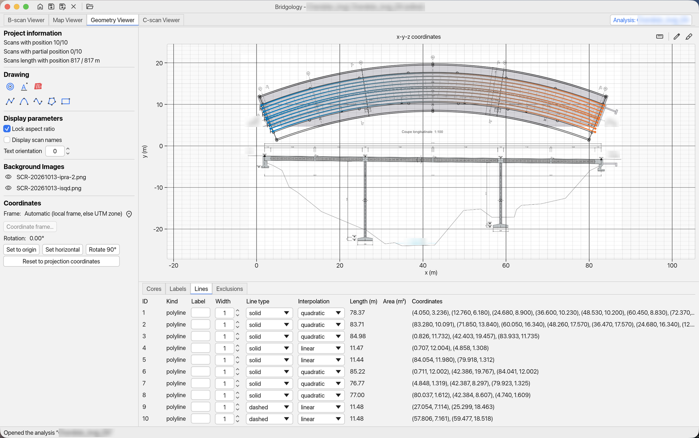
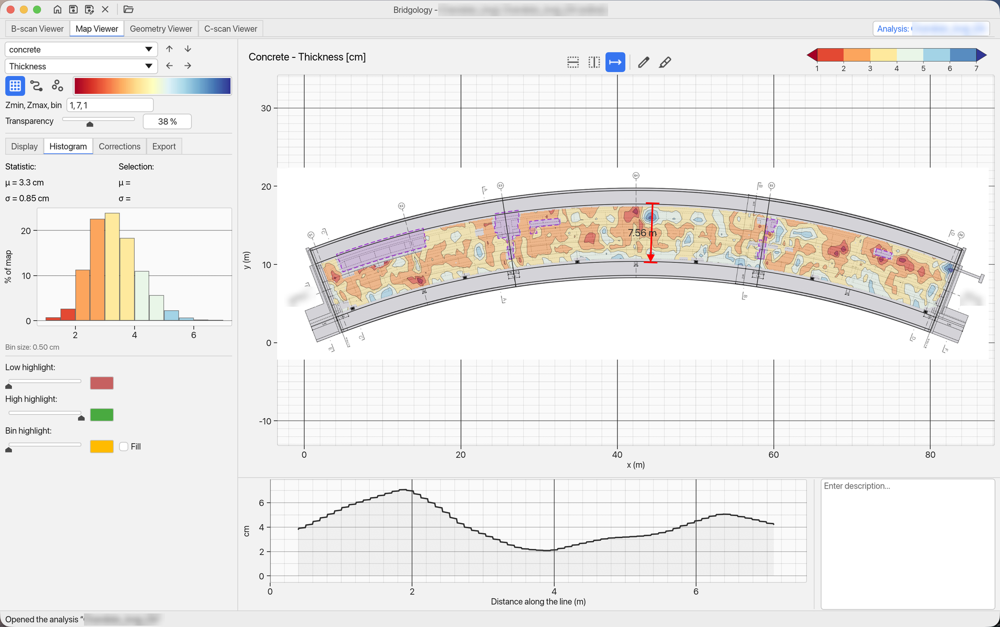

  <a href="https://www.bridgology.com">
    <picture>
      <source media="(prefers-color-scheme: dark)" srcset="docs/images/logo-dark.png">
      
    </picture>
  </a>

<h3 align="center">Ground-penetrating radar analysis for bridges, slabs and walls</h3>

  Turn GPR surveys of concrete and masonry structures into thicknesses, cover depths and clear maps.

  
  &nbsp;
  

  Version 0.12.0 &nbsp;·&nbsp; Free Viewer included &nbsp;·&nbsp; <a href="../../releases">All versions</a>

 

  <picture>
    <source media="(prefers-color-scheme: dark)" srcset="docs/images/bscan-dark.png">
    
  </picture>

 

## What Bridgology does

Import a whole survey straight from your radar's files, pick the layers and rebars on the radargrams, and
Bridgology calculates thicknesses, depths, spacings and material properties, then maps them over the
structure, ready to export for your report.

### Read the radargrams

Clean up each scan with background removal, gain and filters, then pick layers, rebars and other features by
hand or automatically. Measure distances and times directly on the image.

### Place the scans on the site plan

Position every scan from its GPS or a spreadsheet, over a drawing, a photo or an online map of the site. Mark cores,
joints, labels and areas to leave out.

  <picture>
    <source media="(prefers-color-scheme: dark)" srcset="docs/images/geometry-dark.png">
    
  </picture>

### Map the results

Thickness, cover depth, spacing and permittivity, interpolated into maps of the whole deck. Cut
cross-sections, outline areas of interest, and export the maps, the figures and the numbers.

  <picture>
    <source media="(prefers-color-scheme: dark)" srcset="docs/images/map-dark.png">
    
  </picture>

## Works with your radar

| Manufacturer | Files |
|---|---|
| Proceq / Screening Eagle (GP8000, GP8100, GP8800, GS8000, GS9000) | `.sgy` |
| GSSI | `.dzt` (with `.dzx` for 3D grids) |
| MALÅ | `.rad` with `.rd3` / `.rd7` |
| IDS | `.dt` |
| Kontur | `.sgy` |

## Install

**macOS**

1. Click **Download for macOS** above.
2. Open the downloaded file and drag **Bridgology** onto the **Applications** folder.
3. Start Bridgology from your Applications folder.

**Windows**

1. Click **Download for Windows** above.
2. Open the downloaded file and follow the steps. No administrator rights are needed.
3. Start Bridgology from the Start menu.

Bridgology is signed by Bridgology SA, and the macOS version is checked by Apple. Once installed, it
tells you when a new version is out and can install it for you (**Help > Check for updates…**).

## Free Viewer, or the full analysis with a licence

Bridgology is free to download and install. Without a licence key it runs as the **Viewer**, with no time
limit. A licence key turns the same installation into the full analysis software: nothing to reinstall.

| | Free Viewer | With a licence |
|---|:---:|:---:|
| Import radar files from every supported system and save them as a project | ✓ | ✓ |
| View, process and organise the radargrams | ✓ | ✓ |
| Place the scans on the site plan | ✓ | ✓ |
| Build and view C-scan volumes (depth slices) | ✓ | ✓ |
| Open a project delivered to you and read, adjust and export its maps | ✓ | ✓ |
| Describe the structure and pick layers, rebars and other features | | ✓ |
| Calculate thicknesses, depths, spacings and material properties | | ✓ |
| Make your own maps and export results to Excel | | ✓ |

The Viewer is the way to look at a survey Bridgology delivered to you, or to try the software on your own
data before you buy.

To get a licence, write to [info@bridgology.com](mailto:info@bridgology.com) or visit
[www.bridgology.com](https://www.bridgology.com). Enter the key in **Help > Licence key…**.

## System requirements

- A Mac with Apple Silicon (M1 or later), or a PC with Windows 10 or 11 (64-bit)
- An internet connection when the app starts, to check the licence

## Help

The full manual is built into the app: **Help > Help**. For anything else, use **Help > Contact support…**,
write to [info@bridgology.com](mailto:info@bridgology.com), or visit
[www.bridgology.com](https://www.bridgology.com).

 

  © 2026 Bridgology SA

